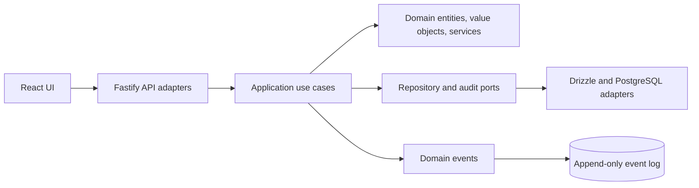

# AMS Educational

An open-source accounting management system and hands-on learning environment for double-entry bookkeeping and modern software architecture. The project demonstrates accounting rules alongside Clean/Hexagonal Architecture, Domain-Driven Design, and CQRS concepts.

## Overview of the project

AMS Educational helps learners explore how a small accounting application can keep its financial rules in a framework-independent domain while exposing them through a web API and user interface. Users can create an organization, work with its sample chart of accounts, post journal entries, and review accounting reports.

The core accounting rule is enforced in code and the database: a journal entry can be posted only when it contains positive debit and credit lines whose exact totals balance. The repository also includes educational documentation that explains the domain model, architecture boundaries, and accounting concepts.

## Features

- **Double-entry bookkeeping:** exact four-decimal monetary values, account types, journal entries, debit/credit postings, and balance validation.
- **Accounts and reporting:** tenant-scoped chart of accounts, account ledger, journal entry list, and trial balance.
- **Auditability:** append-only audit and domain event records for key operations, plus database rules that protect posted financial records.
- **Authentication and access control:** Argon2id password hashing, short-lived access cookies, rotating refresh tokens, role checks, and tenant isolation.
- **Web experience:** register or sign in, create accounts, post journal entries, and review reports in the React application.
- **Educational resources:** architecture and accounting guides, an OpenAPI contract, and documented CI/CD and security workflows.
- **Local containers:** Docker Compose runs PostgreSQL, the API, and the web UI.

## Tech Stack

| Area                   | Technologies                                          |
| ---------------------- | ----------------------------------------------------- |
| Language and workspace | TypeScript, pnpm workspaces, Turborepo                |
| API                    | Node.js 22, Fastify 5, Zod                            |
| Data                   | PostgreSQL 17, Drizzle ORM, `pg`                      |
| Web UI                 | React 19, Vite, TanStack Query, Zustand, Tailwind CSS |
| Tests and quality      | Vitest, TypeScript strict mode, ESLint, Prettier      |
| Local runtime and CI   | Docker Compose, GitHub Actions                        |

## Core Architecture

The system follows dependency inversion: HTTP and database technologies sit at the edges, while accounting policy lives in the domain layer.



- **Domain:** `Account`, `JournalEntry`, `Posting`, `Money`, and `PostingEngine` own accounting concepts and invariants without depending on Fastify or PostgreSQL.
- **Application:** use cases coordinate commands and queries through repository, audit, and event-publisher interfaces.
- **Infrastructure:** Drizzle repositories and PostgreSQL persistence implement the domain-facing ports; the database also enforces important integrity rules.
- **Interface adapters:** Fastify routes validate requests and call use cases; the React UI calls the API. Authentication persistence currently remains in the HTTP adapter and is documented as a boundary improvement.

For more detail, see the [architecture overview](docs/architecture/overview.md) and [domain model](docs/architecture/domain-model.md).

## Quick start

Requirements: Node.js 22+, pnpm 9+, Docker Desktop.

```sh
cp .env.example .env
# Replace the two JWT secrets with distinct random values (32+ characters).
docker compose up --build
```

Open http://localhost:5173, register an organization (a sample chart of accounts is created automatically), then post a balanced entry between the seeded accounts. The API runs at http://localhost:3000. Production deployments must terminate TLS and set COOKIE_SECURE=true.

Local development: `pnpm install`, `docker compose up -d db`, `pnpm db:migrate`, then `pnpm dev`.

Read [architecture](docs/architecture/overview.md), [accounting primer](docs/accounting/double-entry-basics.md), and [security model](docs/security/security-model.md). API contract: [OpenAPI 3.1](docs/api/openapi.yaml). Workflow YAML files are educational process descriptions, not executed by an engine.

Commands: `pnpm test:unit`, `pnpm typecheck`, `pnpm build`. Postgres integration and browser E2E suites remain future work.

## 📄 License

This project is licensed under the **MIT License**
