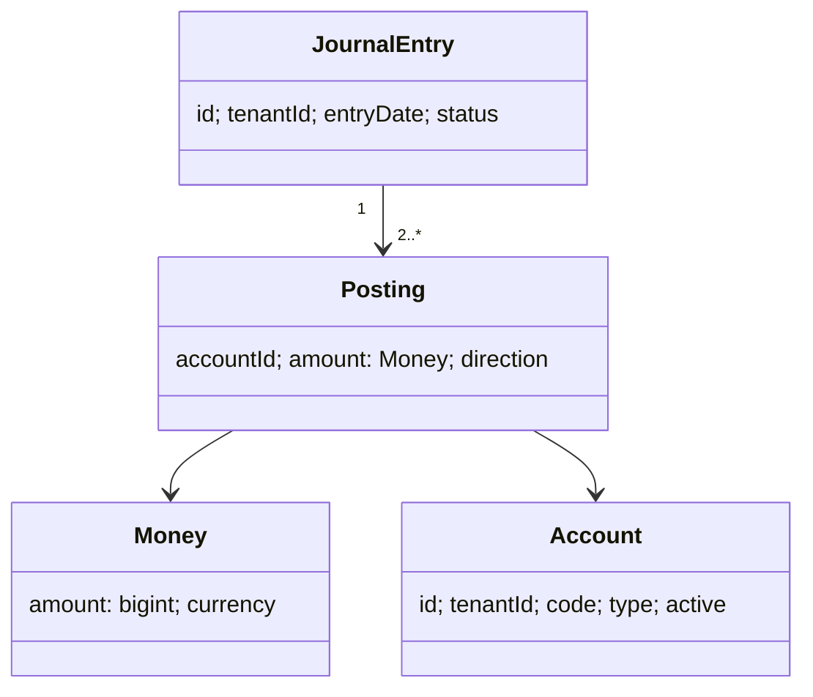

# Domain model

Money parses decimal strings into scaled bigint units at four decimal places, matching NUMERIC(19,4) without floating point rounding. A Posting has a positive amount and explicit direction. JournalEntry is immutable: DRAFT can transition to POSTED once; posted entries are corrected through an inverted reversal. PostingEngine checks line count, currency, positivity, and exact equality. Trial-balance rows apply debit-normal balances to assets and expenses and credit-normal balances to liabilities, equity, and revenue.

