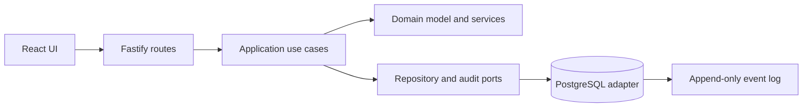

# Architecture overview

Dependencies point toward the accounting core. The domain has no framework dependency: decimal money, immutable posting lines, journal lifecycle, account identity, and PostingEngine live there. Application use cases accept tenant and actor identity from authenticated context and depend on repository/audit ports. PostgreSQL and HTTP are outer adapters.

The accounting and reporting routes delegate to application use cases and Drizzle adapters. Authentication routes remain in the HTTP adapter and use parameterized PostgreSQL transactions; extracting those flows into application use cases is the next boundary improvement.
